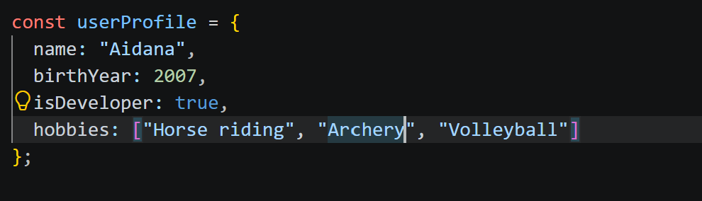
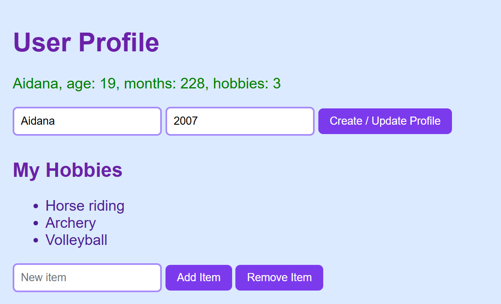
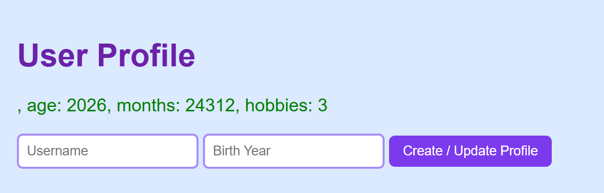
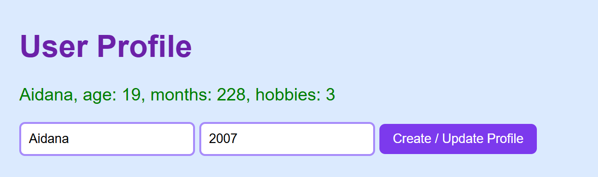
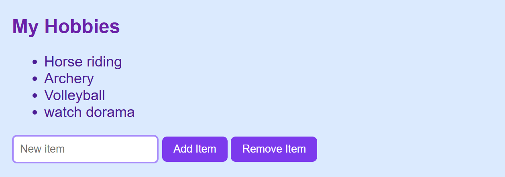
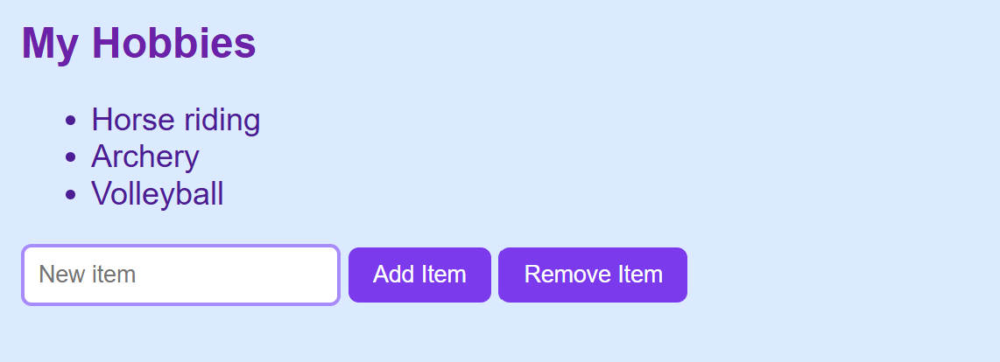

# Assignment 5. JavaScript Basics (DOM Manipulation & Events)
 
Name: AIDANA MURATOVA SE-2539 
GitHub Pages link:
 

## Part 1: Profile Object, Data Types & Arithmetic
 
### Task 1. The Personal Info Object
 
Create a JavaScript const object named userProfile that stores different data types: string (name), number (birthYear), boolean (isDeveloper) and an array (hobbies).
 
I made the userProfile object with const. It has name (string), birthYear (number), isDeveloper (boolean) and hobbies (array with three hobbies).

 

 
### Task 2. Arithmetic Calculations
 
Write a script that uses arithmetic operators to calculate the user's current age dynamically. Calculate another metric (months or hobbies count) and display the values in the console or on the page.
 
I wrote the function showProfile(). It takes the current year with new Date().getFullYear() and subtracts birthYear to get the age. Then I multiplied the age by 12 to get the months, and used hobbies.length to count the hobbies. The results are shown in the console and on the page.
 

 
## Part 2: Form Input & Event Responses
 
### Task 3. HTML Form Setup
 
Create a simple form or input fields: an input for Username, an input for Birth Year and a "Create / Update Profile" button.
 
I added two inputs (text for username and number for birth year) and the button "Create / Update Profile" in index.html.
 

 
### Task 4. Event Listener
 
Add a click or submit event listener to the button. When clicked, capture the user's input values and update the userProfile object.
 
I added a click event listener to the button. When I click it, the code reads the values from both inputs and saves them into userProfile.name and userProfile.birthYear. The birth year comes from the input as a string, so I used Number() to turn it into a number. After that showProfile() runs again and the text on the page changes (and its color becomes purple).
 

  
## Part 3: DOM List Manipulation
 
### Task 5. Creating & Removing Elements
 
Create an unordered list (<ul>) with tasks or hobbies. Create an "Add Item" button that adds a new <li> from user input, and a "Remove Item" button that deletes the last item.
 
I made a <ul> with three hobbies. For the "Add Item" button I take the text from the input, create a new <li> with document.createElement, put the text inside and add it to the list with appendChild. If the input is empty, nothing is added. For the "Remove Item" button I find the last <li> with lastElementChild and delete it with remove().

 

 
## Conclusion
 
First I created index.html with the inputs, buttons and the list. Then I wrote script.js part by part: first the object and the calculations, then the button event for the form, and at the end the add/remove buttons for the list. I tested every part in the browser and checked the console for errors. The hardest part for me was understanding why the value from the input is a string and needs Number(). Also I learned how to create and remove elements with JS. In the end I uploaded the project to GitHub and published it with GitHub Pages.
 

